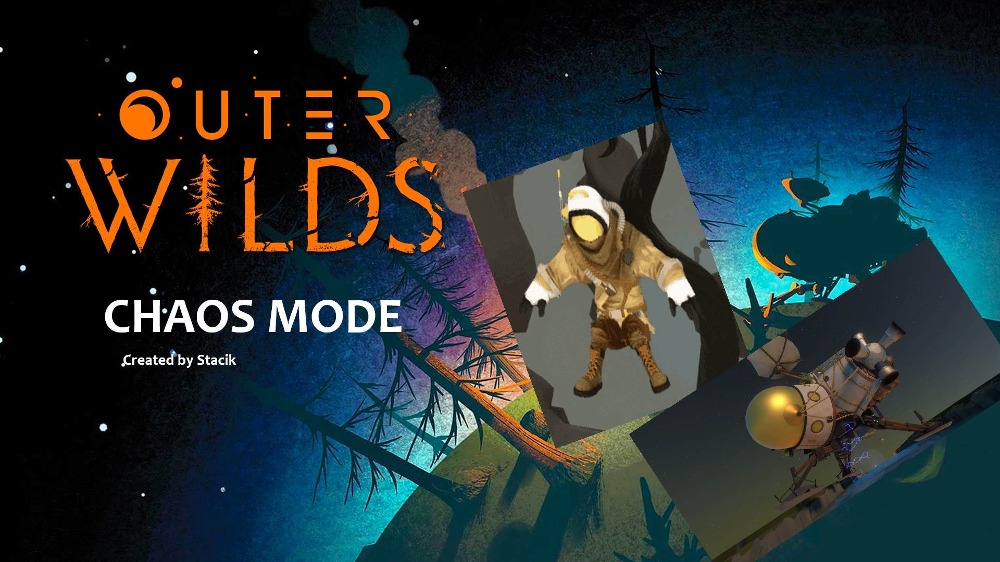

# ChaosMod (OW Edition)
Inspired by GTA 5 mod Chaos Mod

## Features
- Good youtube content
- Makes you rage
- Wastes your time
- It funni
- yes
- settings

## Events (for now, ofc there will be more)
- Low Gravity (20s)
- Fast Forward 30s
- Fake Crash
- Big Guy (20s)
- Remove Spacesuit
- Blow Up Ship
- Flip Screen (7s)
- Deduce Health By 50
- No Sun Explosion music (has to be triggered 3 times in a loop to be activated) - Idea by Hamstry
- Break A Random Ship Part - Idea by Hamstry (again)
- Crash The Moon - Idea by ystoce
- Play End Times
- Play Anglerfish bite sfx
- Play Anglerfish detect sfx
- Job app jumpscare
- Foxy Jumpscare - Idea by wannacrylel
- Acceleration for 0.2s (Dark Bramble only) - Idea by Hamstry
- Reverse Orbits - Idea by miocid74020

## FAQ
### How do I disable a event thats not in settings
You cant
### Why is there not all events in settings
I only put events that made me officially rage while testing
### Is this gonna mess with my computer?
No, if there is an effect outside of outer wilds it is purely cosmetical using tricky stuff
### Why are some effects not announced?? Fix your mod!!!!!
Troll effects aren't announced or else they wouldn't be trolls